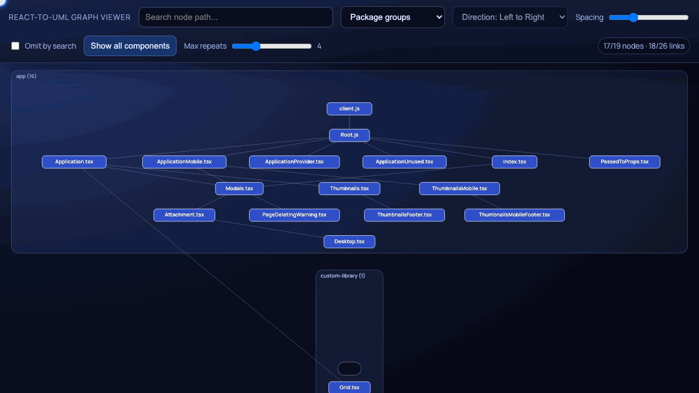

<p align="center">
  <a href="https://github.com/mallchel/react-to-uml/" target="blank">
    
  </a>
</p>

<h3 align="center">
  react-to-uml
</h3>

<p align="center">
  Visualize your react components tree with graph diagram
</p>

<p align="center">
  <a href="https://www.npmjs.com/package/react-to-uml"></a>
  <a href="https://www.npmjs.com/package/react-to-uml"></a>
  <a href="https://www.npmjs.com/package/react-to-uml"></a>
</p>

`react-to-uml` walks your source files from an entry file, finds which React components render which, and shows the result as an interactive graph. It reads files directly, so no Babel or Webpack plugin setup is needed.



## Usage with npx

Run it from your project root and point `ENTRY` at your app entry file:

```sh
ENTRY=./src/main.tsx npx react-to-uml --serve
```

This gathers data, builds the graph and opens the viewer at http://localhost:8207. Leave out `--serve` to only write the JSON files.

To run one step at a time:

```sh
# gather only
IS_GATHER_INFO=true ENTRY=./src/main.tsx npx react-to-uml

# build from earlier gathered data and open the viewer
IS_BUILD_GRAPH=true ENTRY=./src/main.tsx npx react-to-uml --serve

# open the viewer for existing files only
IS_GATHER_INFO=false IS_BUILD_GRAPH=false npx react-to-uml --serve
```

Variables can also go in a `.env` file in the current directory. Variables set in the shell take precedence.

### CLI flags

- `--serve`: start the graph viewer after running (`--run-graph` still works as an alias)
- `--port=<number>`: viewer port (default `8207`, or the `PORT` env var)

### Environment variables

| Variable | Default | Description |
| --- | --- | --- |
| `ENTRY` | `./packages/app/client.js` | Entry file to start walking from |
| `EXTENSIONS` | `jsx,js,tsx,ts` | File extensions to walk |
| `DUMP_DIR` | `./assets` | Output directory |
| `GATHERED_GRAPH_FILE` | `$DUMP_DIR/gatheredComponentsByFileName.json` | Gathered data file |
| `OUT_GRAPH_FILE` | `$DUMP_DIR/treeComponentsGraph.json` | Built graph file. Related files are written next to it, and the viewer serves this directory |
| `IS_GATHER_INFO` | `true` when neither step flag is set | Run the gather step |
| `IS_BUILD_GRAPH` | `true` when neither step flag is set | Run the build step |
| `REPETITIVE_COUNT_FOR_REMOVE_FROM_TREE` | `4` | Starting value of the viewer's "Max repeats" filter, which hides components imported more often than this. Applied in the browser and adjustable there, only with `--serve` |

Relative paths are resolved from the current directory.

## Using the viewer

- **Search** highlights files whose path contains the text. Turn on **Omit by search** to hide everything else.
- **Scroll** to zoom and **drag the background** to pan. In the Force layout you can also drag nodes.
- **Layout**: *Package groups* (default) draws one box per package, in import order. *Hierarchy* places components by render depth, left-to-right or top-to-bottom. *Force* lays nodes out freely.
- **Spacing** spreads the layout out.
- **Max repeats** hides components reached more often than this from the entry, such as buttons and icons used everywhere. It starts at `REPETITIVE_COUNT_FOR_REMOVE_FROM_TREE`. **Show all components** turns this filter off.
- The counter at the top right shows how many nodes and links are visible.

## Outputs

These files are written to `DUMP_DIR`:

- `gatheredComponentsByFileName.json`: raw import, export and JSX data per file
- `treeComponentsGraph.json`: component graph as `[fileName, childFileNames[]]` pairs
- `graphNodeMetaByFileName.json`: package and directory info per node, which the viewer uses for grouping
- `proxyPathsWithJsx.json`: re-exports traced to the files that define the components

A file counts as a component when it exports something that renders JSX: a function, arrow function or class, also when wrapped in HOCs like `connect(...)(App)`, `memo(...)` or `compose(...)(App)`. Re-exports (`export { default as X } from`, `export * from`, or import then export) are followed to the file that defines the component. Imports through dynamic `import()` / `React.lazy` are not followed.

Node ids are file paths relative to the **deepest folder shared by all walked files**. In a monorepo, a graph that reaches `packages/app` and `packages/ui` gets ids like `/app/Root.tsx` and `/ui/Button.tsx`. Imports through workspace symlinks resolve to the real source files, and files under `node_modules` and `.d.ts` files are skipped.

## Programmatic usage

```sh
npm i -D react-to-uml
```

```ts
import { runGatherInfo, runBuildGraph, startViewer } from 'react-to-uml';

runGatherInfo({
  entryFileName: './src/main.tsx',
  outFileName: './assets/gatheredComponentsByFileName.json',
});

runBuildGraph({
  entryFileName: './src/main.tsx',
  gatheredGraphFilePath: './assets/gatheredComponentsByFileName.json',
  outGraphFileName: './assets/treeComponentsGraph.json',
});

startViewer({ dumpDir: './assets', port: 8207 });
```

### Exports

- `runGatherInfo({ entryFileName, outFileName, acceptableExts? })`: walk files and write gathered data. Returns the gathered graph.
- `runBuildGraph({ entryFileName, gatheredGraphFilePath, outGraphFileName, repetitiveCountForRemoveFromTree? })`: build the graph files from gathered data.
- `runFromEnv()`: what the CLI runs. Reads the env vars above and returns `{ outputDir }`.
- `startViewer({ dumpDir, port?, viewerConfig? })`: serve the built viewer plus the JSON files in `dumpDir`. `viewerConfig.repetitionLimit` sets the starting "Max repeats" value.
- `gatherGraph(options)` / `buildGraphFromGraph(options)`: lower-level versions that work in memory.
- Types: `GatheredGraph`, `GatheredModuleConnection`, `GatherOptions`, `BuildOptions`.

### Options

- `acceptableExts?: string[]`: default `['jsx', 'js', 'tsx', 'ts']`. File extensions used for walking.
- `repetitiveCountForRemoveFromTree?: number`: default `4`. Only affects the `usedUserRequests` set that `runBuildGraph` returns. The written JSON always contains the full graph, and the viewer filters it.

## Migrating from 1.x

- `runBuildUml` is now `runBuildGraph`, and its `outUmlFileName` option is now `outGraphFileName`.
- `buildUmlFromGraph` is now `buildGraphFromGraph`.
- `packagesPaths` / `PACKAGES_PATHS_REGEX` are removed. Paths are worked out automatically.
- `isGroupByParentDirNeeded` / `IS_GROUP_BY_PARENT_DIR` are removed. The viewer groups nodes by package.
- `REPETITIVE_COUNT_FOR_REMOVE_FROM_TREE` now sets the viewer's starting filter value and no longer affects the build.
- `IS_BUILD_UML` / `OUT_UML_FILE` are now `IS_BUILD_GRAPH` / `OUT_GRAPH_FILE`.
- The output file `treeComponentsUML.json` is now `treeComponentsGraph.json`, and the default output folder is `./assets` instead of `./build/assets`.

## Developing this repo

```sh
yarn
```

| Script | What it does |
| --- | --- |
| `yarn sample` | Gather + build the sample app in `packages/app` and open the viewer |
| `yarn sample:gather` | Gather step only, for the sample app |
| `yarn sample:graph` | Build step + viewer, for the sample app |
| `yarn sample:app` | Run the sample React app itself |
| `yarn target` | Gather + build the repo set by `ENTRY` in `.env` and open the viewer |
| `yarn target:gather` | Gather step only, for the target repo |
| `yarn target:graph` | Build step + viewer, for the target repo |
| `yarn dev:viewer` | Viewer in dev mode with hot reload, reading JSON from `DUMP_DIR` (`REPETITIVE_COUNT_FOR_REMOVE_FROM_TREE` is ignored here) |
| `yarn build` | Clean `lib/`, compile the library and build the viewer (what gets published) |
| `yarn test` / `yarn test:watch` | Run tests once / in watch mode |

To analyze another local repo, create `.env` in this repo:

```sh
ENTRY=../my-app/src/main.tsx
```

then run `yarn target`. Pass extra flags after the script name, e.g. `yarn target --port=8210`.

### Publishing

`npm publish` runs tests and `yarn build` through `prepublishOnly`. Only `lib/` is published, and it holds the compiled CLI, the library and the built viewer.

## Troubleshooting

- Debug logs: `debugLog` in `src/utils.ts` prints only when the command is run with `--debug`.

- `Entry file not found`: set `ENTRY` to an existing file. Relative paths are resolved from the current directory.
- `Graph viewer assets are missing`: when working in this repo, run `yarn build:viewer` first. The `sample` / `target` scripts do this for you.
- Empty graph: make sure the entry renders components through imports with supported extensions (`EXTENSIONS`).
- Port busy: add `--port=8210`.

## What is next?

Once the data is gathered, more can be collected along the way, for example:

1. Test coverage for each file and component
2. Size of files and components
3. Component names inside files that hold several components
